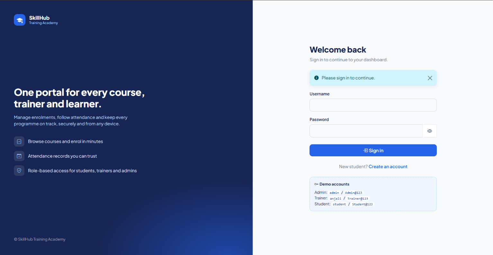
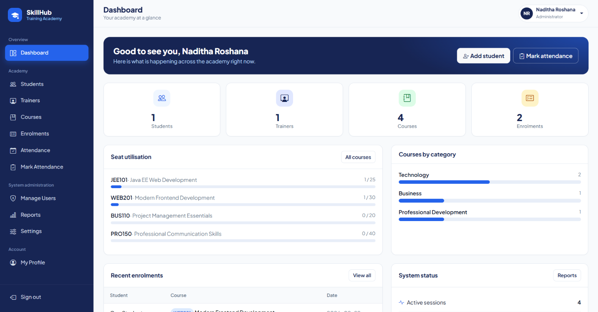
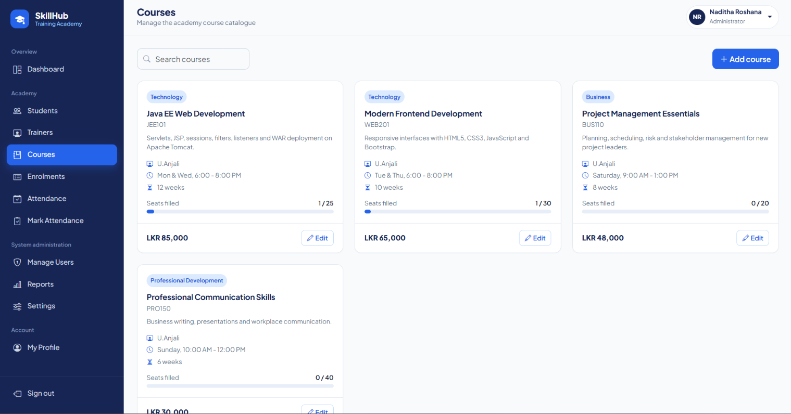
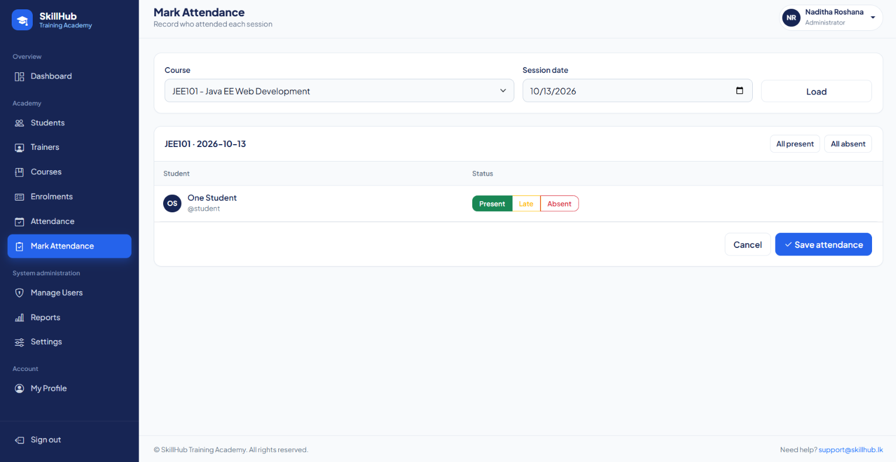

<div align="center">

# SkillHub Training Academy Portal

**A role-based training management web application built with Java EE Servlets and JSP.**
Manage students, trainers, courses, enrolments and attendance, with no database required.


</div>

---

## Overview

SkillHub Training Academy is a fictional professional training organisation. This project is a web portal that replaces
its manual administration with a secure, browser-based system for three kinds of users:

| Role | What they can do |
|---|---|
| **Student** | Register, browse courses, enrol, view their attendance, update their profile |
| **Trainer** | View assigned courses and the attendance of their students, update their profile |
| **Administrator** | Manage students, trainers, courses and enrolments, mark attendance, manage users, configure the app, view reports |

The application was built for the *Web Component Development I* unit. It uses **only Java EE scopes and in-memory data
structures**, and it shows how the core web-container features fit together: servlets, JSP, `RequestDispatcher`,
filters, listeners, `ServletContext`, session tracking and security.

## Screenshots

> Add your screenshots to `docs/screenshots/` and keep these file names, or edit the paths below.

| Login | Admin dashboard |
|---|---|
|  |  |

| Courses | Mark attendance |
|---|---|
|  |  |

## Features

- **Role-based dashboards** with stat cards, seat utilisation, recent activity and quick actions
- **Course catalogue** with search, seat availability and one-click enrolment
- **Enrolment rules**: no duplicate enrolments, seat limits enforced
- **Attendance** marking (Present / Late / Absent) with per-student and per-course reports
- **System administration**: activate or deactivate accounts, reset passwords, change application settings, view reports and export enrolments as CSV
- **Responsive UI** in a Sri Lankan-inspired maroon, green and gold theme that works on desktop, tablet and phone
- **Activity log** written by listeners (sign-ins, sign-outs, changes, denied access attempts)

## Tech stack

| Layer | Technology |
|---|---|
| Language | Java 11+ |
| Web | Servlet 4.0, JSP 2.3, JSTL 1.2 (Java EE 8, `javax.*`) |
| Container | Apache Tomcat 9 |
| Build | Maven (WAR packaging) |
| Front end | HTML5, CSS3, JavaScript, Bootstrap 5.3, Bootstrap Icons |
| Data | In-memory collections held in the `ServletContext` (no database) |

## Getting started

### Prerequisites
- JDK 11 or newer
- Apache Tomcat **9.0.x** (Tomcat 10+ will not work because it uses `jakarta.*`)
- Maven 3.8+ (or the Maven bundled with IntelliJ IDEA)
- Internet access in the browser (Bootstrap, icons and the font load from a CDN)

### Run in IntelliJ IDEA
1. Clone the repository and open the folder that contains `pom.xml`:
   ```bash
   git clone https://github.com/<your-username>/skillhub-portal.git
   ```
2. Wait for Maven to import the dependencies.
3. Go to **Run > Edit Configurations > + > Tomcat Server > Local** and select your Tomcat 9 folder.
4. On the **Deployment** tab add the artifact **skillhub-portal:war exploded** and set the application context to `/skillhub`.
5. Run it and open <http://localhost:8080/skillhub/>.

### Build a WAR and deploy manually
```bash
mvn clean package
cp target/skillhub.war $CATALINA_HOME/webapps/
```
Start Tomcat and open <http://localhost:8080/skillhub/>.

## Demo accounts

> Demo data is loaded automatically at startup. These credentials exist for demonstration only.

| Role | Name | Username | Password |
|---|---|---|---|
| Administrator | Nuwan Perera | `nuwan` | `Nuwan@2026` |
| Trainer | Dilani Fernando | `dilani` | `Dilani@2026` |
| Trainer | Sanjeewa Jayasinghe | `sanjeewa` | `Sanjeewa@2026` |
| Trainer | Thilini Wickramasinghe | `thilini` | `Thilini@2026` |
| Student | Kasun Rajapaksha | `kasun` | `Kasun@2026` |
| Student | Sathyaa Kandasamy | `sathya` | `Sathya@2026` |
| Student | Ishara Gunawardena | `ishara` | `Ishara@2026` |
| Student | Mohamed Farhan | `farhan` | `Farhan@2026` |
| Student | Hirushi Senanayake | `hirushi` | `Hirushi@2026` |
| Student | Tharindu Bandara | `tharindu` | `Tharindu@2026` |

The demo data is Sri Lankan: eight courses (fees in LKR) taught in Colombo, Kandy, Galle and Jaffna.

Data is stored in memory, so everything you add is cleared when Tomcat restarts.

## Architecture

```
Browser
   |  HTTP request
   v
Filters:  Encoding > Security headers > Authentication > Authorization > CSRF
   |
   v
Servlet (controller)  --->  InMemoryStore (ServletContext attribute)
   |
   |  RequestDispatcher.forward()
   v
JSP + JSTL (view, under /WEB-INF so it is never reachable directly)
```

Listeners observe the whole life cycle: application start (load data and settings), session creation and destruction,
sign-in and sign-out, and every request.

### Project structure

```
skillhub-portal/
├── pom.xml
└── src/main
    ├── java/com/skillhub
    │   ├── filter/     Encoding, SecurityHeaders, Authentication, Authorization, Csrf
    │   ├── listener/   AppContext, SessionTracking, RequestStats
    │   ├── model/      User, Role, Course, Enrolment, Attendance
    │   ├── servlet/    Login, Logout, Register, Dashboard, Course, Enrolment,
    │   │               Attendance, AttendanceMark, Profile, Admin* (students,
    │   │               trainers, users, settings, reports)
    │   ├── store/      InMemoryStore (all application data)
    │   └── util/       PasswordUtil, Validation, Flash, WebUtil
    └── webapp
        ├── WEB-INF/    web.xml, jsp/ (15 pages), jspf/ (shared layout fragments)
        ├── assets/     css/style.css, js/app.js
        └── index.jsp
```

### Use cases to URLs

| Use case | Actor | URL |
|---|---|---|
| Register account | Student | `/register` |
| Login / Logout | All | `/login`, `/logout` |
| View courses / assigned courses | Student, Trainer, Admin | `/courses` |
| Enrol in a course | Student | `/enrolments` |
| View attendance | Student, Trainer | `/attendance` |
| Update profile | All | `/profile` |
| Manage students | Admin | `/admin/students` |
| Manage trainers | Admin | `/admin/trainers` |
| Manage courses | Admin | `/courses` |
| Manage enrolments | Admin | `/enrolments` |
| Mark attendance and view the report | Admin | `/attendance/mark`, `/attendance` |
| Manage users, configure, reports | Admin | `/admin/users`, `/admin/settings`, `/admin/reports` |

## Security

| Area | Implementation |
|---|---|
| Authentication | Login required for every page except sign-in and registration |
| Authorisation | Role-based checks in `AuthorizationFilter`, repeated inside servlets |
| Passwords | Salted PBKDF2-HMAC-SHA256 hashes, never stored in plain text |
| Sessions | New session ID at login (prevents fixation), HttpOnly cookie, 20 minute timeout |
| CSRF | Per-session token required on every POST form |
| Brute force | Account lockout for 5 minutes after 5 failed sign-ins |
| XSS | All output escaped with `<c:out>`; Content-Security-Policy header; no inline scripts |
| Other | Security headers, no-store caching on private pages, JSPs hidden under `WEB-INF`, unused HTTP methods blocked in `web.xml`, CSV export protected from formula injection |

## Configuration

Default settings live in `web.xml` as context parameters (`academyName`, `supportEmail`, `defaultCapacity`,
`registrationOpen`). Administrators can change them at runtime on the **Settings** page. For HTTPS deployments, enable
`<secure>true</secure>` on the session cookie in `web.xml`.

## Roadmap

- [ ] Persistent storage (JDBC or JPA) in place of in-memory data
- [ ] Enrolment cancellation and waiting lists
- [ ] Trainer-side attendance marking
- [ ] Email notifications
- [ ] Migration to Jakarta EE 10 and Tomcat 10+
- [ ] Automated tests (JUnit and Selenium)

## Academic note

This project was created for educational purposes as part of a Web Component Development coursework assessment.
If you are a student, use it to learn from rather than to submit as your own work.

## License

Released under the [MIT License](LICENSE).

## Author

**Your Name**
GitHub: [Naditha-Roshana](https://github.com/Naditha-Roshana)
